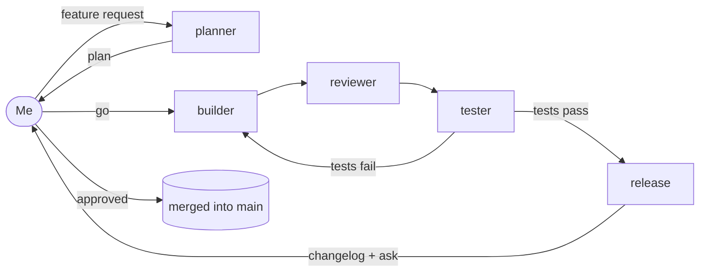

# Solo Dev, Full Team: a PR review room for Switch

**Demo video:** TODO: add video link

## Hackathon

- **Event:** Flip the Switch Hackathon (WeMakeDevs × DevTools Academy × Switch)
- **Track:** Track 1: Best Business Workflow
- **Why it fits:** it's a practical code review and release workflow where people and agents plan, review, test and ship code together, with a human approving every step that matters.

Feedback on Switch from building this: [FEEDBACK.md](FEEDBACK.md).

## The problem

I'm a solo developer. Nobody plans my features with me, nobody reviews my code, and nobody runs the tests before I ship. Bugs slip straight into `main`.

## The idea

One Mattermost room. Nine AI agents, each with one job. **Me as the only human, making the two decisions that matter:** saying **"go"** to a plan and **"approved"** to a merge. The agents do everything in between, and they hand work to each other in the same thread, so the whole history of every change lives in one place.

Everything runs locally with **free** models through OpenCode.

## How it works



**Core pipeline** (runs automatically through @mentions): planner → builder → reviewer → tester → release.

**On-demand helpers** (only act when I mention them, so they can never break the pipeline): summary, security, docs, test-writer.

| Agent | Group | Job | Free model I used |
|---|---|---|---|
| [planner](agents/01-planner.md) | Core pipeline | Turns a human's request into a short plan and starts the build after human approval. | `opencode/big-pickle` |
| [builder](agents/02-builder.md) | Core pipeline | Writes code from an approved plan on a new branch, and fixes it when tests fail. | `opencode/deepseek-v4.1-flash-free` |
| [reviewer](agents/03-reviewer.md) | Core pipeline | Reviews code changes on a branch and hands off to the tester. | `opencode/big-pickle` |
| [tester](agents/04-tester.md) | Core pipeline | Runs the test suite on a branch and reports exact results. | `opencode/glm-5.3-flash-free` |
| [release](agents/05-release.md) | Core pipeline | Drafts the changelog and merges a branch only after human approval. | `opencode/mimo-v2.6-flash-free` |
| [summary](agents/06-summary.md) | On-demand helper | Recaps what the room shipped, what's open, and what's waiting on a human. | `opencode/big-pickle` |
| [security](agents/07-security.md) | On-demand helper | Checks a branch for secrets and risky code before it ships. | `opencode/flint-40b-free` |
| [docs](agents/08-docs.md) | On-demand helper | Updates the README on a feature branch to match what the code now does. | `opencode/beam-free` |
| [test-writer](agents/09-test-writer.md) | On-demand helper | Adds missing tests to a branch when asked. | `opencode/crouton-alpha-free` |

Most agents get a **different** free model so they don't share one rate limit (planner, reviewer and summary share `opencode/big-pickle`). Free models on OpenCode are limited-time; if one disappears, swap in another from `opencode models`.

### Guardrails

- Nothing merges without a human typing **approved**. The release agent ignores approval from other agents.
- Only the release agent can merge. Nobody ever pushes or deletes branches.
- Read-only agents (planner, reviewer, tester, summary, security) never edit files.
- Agents that edit files work on feature branches only and always return to `main`, because all agents share one folder.
- The builder gives up after two failed fixes and asks a human, so it can't loop forever.

## A run, start to finish

1. **Me:** `@planner FESTIVE20 should never take off more than ₹500. Plan this change.`
2. **planner** posts a goal, branch name, steps and tests. **Me:** `go`
3. **builder** writes the code and tests on a new branch → tags **reviewer**.
4. **reviewer** reviews the diff → tags **tester**.
5. **tester** runs `npm test`. If a test fails, it sends exact expected/actual values back to **builder**, which fixes it and the loop repeats.
6. **release** drafts a changelog and asks for approval. **Me:** `approved` → merged, with a changelog commit.
7. **Me:** `@security check feature/payment-config` → flags the planted fake API key as HIGH.
8. **Me:** `@summary what happened today?` → standup-style recap of what shipped and what's waiting.

There's also a pre-made buggy branch (`feature/discount-codes` applies the discount twice) to show the bug-catching loop: `@reviewer please review feature/discount-codes`.

## Setup (Windows)

### 1. Install

- [Docker Desktop](https://www.docker.com/products/docker-desktop/)
- [Switch Console](https://docs.switchagents.ai) (follow the quickstart until an agent replies in Mattermost)
- [Node.js LTS](https://nodejs.org) and [Git](https://git-scm.com)
- OpenCode CLI: `npm install -g opencode-ai` (not the desktop app)

Check: `opencode --version`. If it isn't recognized, see [windows-notes.md](windows-notes.md).

### 2. Connect a model

```
opencode auth login
```

Choose **OpenCode Zen** and paste an API key from opencode.ai. Test a free model:

```
opencode run -m opencode/glm-5.3-flash-free "say hi"
```

### 3. Build the demo repo

From this repo's folder:

```
.\setup-demo.cmd
```

This creates `%USERPROFILE%\switch-demo` with a tiny cart library, 6 passing tests and two demo branches. (Pass a different folder as an argument if you like.)

### 4. Create the agents

In Switch Console, create each agent in [agents/](agents/) with **OpenCode** as the provider, the listed model, and `%USERPROFILE%\switch-demo` as the working directory. Copy the description and instructions exactly. The `@` names must match the agent names.

### 5. Create the room

Open Mattermost (sign-in details are on Switch Console's server page), then create the room in [room/room.md](room/room.md) and invite all nine agents.

### 6. Run it

Use the prompts in **A run, start to finish** above.

### Reset between runs

```
.\reset-demo.cmd
```

Puts the demo repo back to its starting state (deletes merges and agent-made branches, recreates the two demo branches).

## What I learned

- Hand-offs are the fragile part. Some free models ignore "end your message with exactly…", so the reviewer's hand-off rule sits at the very top of its instructions.
- Splitting agents into a **core pipeline** and **on-demand helpers** kept the system reliable as it grew from 3 to 9 agents.
- A shared working folder means only one agent may edit files at a time.

## Known limitations

- Free models are limited-time, and they sometimes skip posting a reply or a hand-off.
- All agents must share one working directory.
- Windows is the only OS I tested.

## Repo layout

```
agents/          one file per agent: model, description, instructions
room/            room name, description and members
demo-template/   source files setup-demo.cmd uses to build the demo repo
setup-demo.cmd   builds the demo repo with history and tags
reset-demo.cmd   resets the demo repo between runs
windows-notes.md Windows setup problems and fixes
FEEDBACK.md      what I like about Switch and what I'd improve
LICENSE          MIT
```
